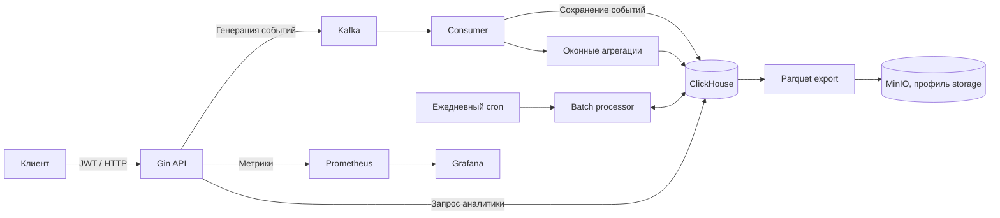

# Real-Time Event Analytics

Go-сервис для сбора и анализа событий: просмотров страниц и действий пользователей. Kafka отделяет приём событий от записи, ClickHouse хранит данные для аналитических запросов. Проект демонстрирует полный путь события от HTTP-запроса до отчёта и метрик.

## Возможности и стек

- Генерация тестовых событий через API, обработка Kafka по разделам с повторными попытками.
- Аналитика кликов по страницам с фильтрами по времени и пользователю.
- Оконные агрегации и ежедневная обработка по cron.
- JWT, роли `admin` / `viewer`, ограничение частоты запросов, аудит действий администратора.
- Go 1.24+, Gin, IBM Sarama, ClickHouse, Kafka + Zookeeper, Docker Compose.
- Дополнительно: Prometheus, Grafana, Loki и Promtail в профиле `monitoring`.

## Архитектура



Точка входа — `cmd/api`. HTTP, consumer и планировщик работают в одном процессе. Код разделён на `handler`, `service`, `repository`; конфигурация находится в `internal/config`.

## Локальный запуск

Нужен Docker с Compose v2. Go требуется только для запуска вне контейнера и тестов.

```sh
cp .env.example .env
docker compose up -d --build --wait
curl http://localhost:8080/health/ready
```

В PowerShell вместо `cp` можно использовать `Copy-Item .env.example .env`. Учётные данные в примере предназначены для локального демо; сервисы опубликованы на `127.0.0.1`. Настройки из `.env` Compose передаёт контейнерам явно.

Пример работы в PowerShell:

```powershell
$login = Invoke-RestMethod -Method Post -Uri http://localhost:8080/api/auth/login `
  -ContentType application/json -Body '{"username":"admin","password":"admin123"}'
$headers = @{ Authorization = "Bearer $($login.token)" }

Invoke-RestMethod -Method Post -Uri http://localhost:8080/api/sources `
  -Headers $headers -ContentType application/json `
  -Body '{"topic":"events","count":10,"interval":0}'

# Consumer сохраняет события асинхронно; запросите отчёт через несколько секунд.
Invoke-RestMethod -Uri 'http://localhost:8080/api/query?limit=10' -Headers $headers
```

API: [localhost:8080](http://localhost:8080/health/ready). Мониторинг запускается отдельно:

```sh
docker compose --profile monitoring up -d --wait
```

[Grafana](http://localhost:3000) — `admin` / пароль `GRAFANA_ADMIN_PASSWORD` из `.env`; [Prometheus](http://localhost:9090).

Для запуска Go на хосте экспортируйте переменные из `.env` в окружение и задайте `KAFKA_BOOTSTRAP_SERVERS=localhost:29092`, `CLICKHOUSE_HOST=localhost`, затем выполните `go run ./cmd/api`. Сам Go-процесс файл `.env` не читает.

## API

Защищённые методы принимают `Authorization: Bearer <token>`.

| Метод | Маршрут | Доступ | Назначение |
|---|---|---|---|
| POST | `/api/auth/login` | Публичный | JSON `username`, `password`; возвращает `token`, `role` |
| POST | `/api/sources` | admin | Публикация: `topic`, `count` (1–100), `interval` (0–1000 мс) |
| GET | `/api/query` | viewer, admin | Клики по страницам: `start_time`, `end_time` (Unix seconds), `page_url`, `user_id`, `limit` (1–1000) |
| POST | `/api/process` | admin | Дневная агрегация: `metric_name: "click_count"`, `date: "YYYY-MM-DD"` |
| POST | `/api/batch/export` | admin | Экспорт вчерашних событий в MinIO как Parquet; нужен профиль `storage` |
| POST | `/api/batch/aggregate` | admin | Пересчёт вчерашней дневной статистики |
| POST | `/api/batch/cleanup` | admin | Удаление временных Parquet-файлов |
| POST | `/api/cleanup/events?days=30` | admin | Удаление событий старше указанного срока |
| POST | `/api/cleanup/minio?days=30` | admin | Удаление старых объектов MinIO |
| POST | `/api/optimize/clickhouse` | admin | Оптимизация таблицы событий |
| GET / HEAD | `/health` | Публичный | Проверка живости процесса |
| GET / HEAD | `/health/ready` | Публичный | Проверка доступности ClickHouse |
| GET | `/metrics` | Публичный | Метрики Prometheus |

`/api/sources` отвечает после публикации в Kafka; запись в ClickHouse выполняется отдельно. Суммарная пауза генерации ограничена 10 секундами. Используйте настроенный топик `events`. Raw SQL через API отключён.

## Проверки и ограничения

```sh
go test -short ./...
go vet ./...
# После запуска Compose — интеграционный тест настоящего Kafka:
go test ./test/integration -run TestKafka_ProducerConsumer_Integration -count=1
# С профилем storage — также дневной пересчёт и проверка Parquet в MinIO:
go test ./test/integration -count=1
# Сквозное демо API → Kafka → ClickHouse:
powershell -ExecutionPolicy Bypass -File test/smoke.ps1
```

Доставка — **at least once**: при сбое записи offsets не подтверждаются, раздел повторяет batch. Повторные записи возможны; API считает уникальные `event_id`. Невалидные сообщения отбрасываются с логом и счётчиком. Оконные агрегаты находятся в памяти и не являются гарантированно точными при перезапуске; исходные события служат основой для отчётов.

MinIO запускается командой `docker compose --profile storage up -d`; Airflow с MinIO — `docker compose --profile batch up -d`. DAG изначально приостановлены, перед каждым вызовом API получают свежий JWT. Расписание использует UTC. Это локальный MVP, без заявления о production-ready эксплуатации или финансовых суммах транзакций.

Остановка с сохранением данных: `docker compose down`. Kafka, Zookeeper и ClickHouse используют именованные volumes. `clickhouse-init` проверяет схему перед запуском API. Старая таблица событий при обновлении сохраняется как `events_legacy`; volumes не удаляются.
